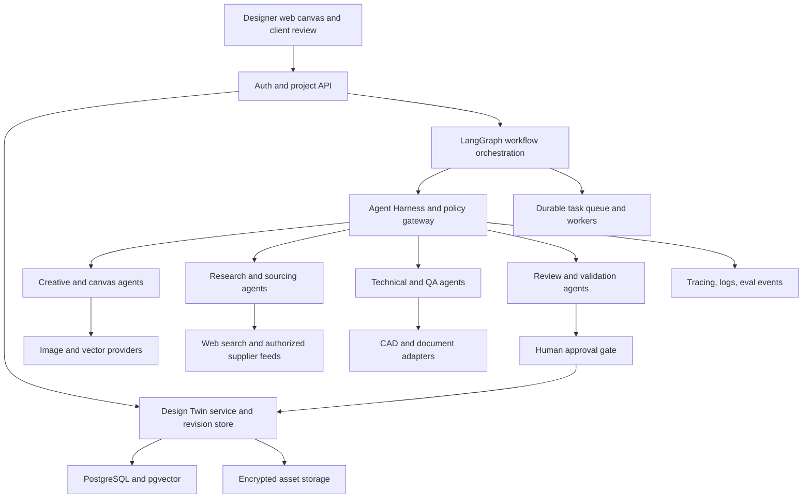

# AtelierOS 3.0 — AI-Native Fashion Creation, Engineering & Product Intelligence

**Comprehensive research-informed product strategy, multimodal architecture, agent harness, and execution specification**  
**Date:** 3 November 2026  
**Status:** Proposed solution, not a built or field-validated platform. Industry assertions are cited; scored priorities, market positioning, timelines and target metrics are hypotheses.

## 1. Executive thesis and correction of scope

AtelierOS is not a chatbot that makes fashion photos, nor only a sketch-to-tech-pack pipeline. It is a **designer-controlled workspace that connects the entire fashion product lifecycle**: market and cultural research; consumer discovery; original concept generation; hand drawing and AI-assisted editable sketching; textile and surface design; fitting and technical development; fabric and trim discovery; pricing; supplier communication; sample feedback; product release; and post-launch learning. The **Digital Garment Twin (DGT)** is the versioned canonical business object connecting all these activities.

The previous AtelierOS concept focused on an important but limited beachhead: preserve designer-approved features when fabric, budget, measurements, or construction requirements change. **That use case is retained as a major differentiator**. The expanded architecture adds upstream discovery and creative tooling and downstream manufacturing, customer, and sustainability functions, with a product strategy that avoids simultaneously building a new Adobe Illustrator, CLO, PLM, and e-commerce system.

**North-star user outcome:** A designer starts from an inspiration question or client brief and ends with a professionally reviewable product package—original design assets, editable drawing, technical draft, alternative materials with verified claims, costs, decisions, approvals, and sample feedback—without losing provenance or creative intent at each handoff.

**Non-negotiable principle:** Generative images are evidence of an aesthetic suggestion, not physical garment fit, sewing feasibility, supplier availability or regulatory compliance. The system must explicitly label what is proposed, verified, simulated, physically tested or approved.

## 2. Industry evidence and competitive landscape

Zara's parent Inditex documents AI virtual try-on as a consumer discovery feature, not proof of AI-operated garment design. Raspberry AI markets sketch-to-render and editable tech packs; Lectra's Apogy offers generative concepts, pattern collaboration, material estimation and product connectivity; Centric's AI Studio integrates creative workflows into PLM and Centric AI Agents address workflows such as BOM and tech-pack preparation. CLO offers advanced digital garment and pattern workflows and is expanding AI and agent support. The research-based conclusion is that **AI fashion ideation, tech packs and broad workflows are existing categories**. AtelierOS must compete with a narrow, measurable advantage: *editable multimodal collaboration plus evidence-backed change propagation for smaller design teams*, then expand using partners and integrations. See source register for direct official links.

| Category | Representative products and evidence | What already exists | Defensible AtelierOS hypothesis |
|---|---|---|---|
| Fast-fashion and retail | Inditex/Zara AI try-on | Consumer visualization and shopping experimentation | Feed customer insights into designer-approved briefs, not a cloned try-on app |
| Visual concept design | Raspberry AI, Adobe creative tools | Sketch rendering, variations, image editing, vector pattern creation | Persistent semantic shapes, editable designs, constraint-preserving revisions |
| Enterprise fashion product development | Lectra Apogy, Centric AI Studio/Agents, PTC FlexPLM | PLM, technical specification, BOM, pattern and product links | Accessible multi-tenant studio for independent/boutique teams with transparent evidence |
| CAD/3D | CLO, Browzwear | Engineering-oriented patterns, drape and 3D workflows | Import/export and review integrations, not in-house physical simulation at MVP |
| Trend and forecasting | Heuritech, WGSN-type licensed content | Paid trend analytics and market intelligence | Evidence-backed search + directly actionable creative briefs; no invented forecasts |
| Research prototypes | AIpparel, ChatGarment, Design2GarmentCode, SewingLDM | Multimodal experimental sewing-pattern generation | Optional R&D route after correctness benchmarks and patternmaker review |

**Competitive red lines:** Do not claim first-ever agentic fashion design, automatic production-ready patterns from photos, exact textile physics from a reference picture, or proprietary vendor platform access without documented integration rights.

## 3. Segments, buyers, and differentiated adoption strategy

The first **buyer** should be an owner of a small or medium boutique studio or made-to-order label, where a single commission passes among the designer, client, tailor, fabric supplier and sometimes a patternmaker. The primary **end user** is the designer, with occasional invited client and supplier roles. The near-term **deployment wedge** is Indian occasionwear, custom apparel, and small collection development: an accessible segment with multiple fabric changes, embellishment choices, localized style references, and repeated client revisions. This is a hypothesis to validate with 15–25 interviews across working studios; it is not a market-size claim.

The adjacent personas are textile/print designers, merchandisers, collection planners, technical designers, patternmakers, production coordinators, apparel students, fashion educators, sampling teams, and marketing teams. Footwear, bags and jewelry need different schemas and engineering validators; they should be independently scoped expansion packs rather than implicitly supported by the garment engine.

For the first customer, the killer workflow is **commission-to-approval-to-sample revision**, where the AI can preserve visual intent despite budget and material constraints. For a larger brand, a second valuable workflow is **collection consistency and reuse**. For suppliers, a third workflow is **quote and alternate-material comparison**. Each must have its own approval semantics and measurable success definition.

## 4. Product structure: seven connected workspaces

### 4.1 Discover — fashion intelligence and evidence-backed web research

A research agent searches publicly accessible fashion history, techniques, runway coverage, collection pages, customer trends, textile finishing processes, vendor documents, sourcing leads and sustainability standards. It retrieves dated and attributed evidence, not just model memory. A user can request an India-specific festive palette or compare vintage embroidery vocabulary, with a citation board that distinguishes descriptions from licensed images and unsupported predictions. Internal documents, licensed trend subscriptions, past brand archives and user-provided product sales can be connected separately with authorization. The agent translates research into moodboards and design opportunities, but does not plagiarize a competitor's identifiable commercial design.

Outputs: research brief with explicit source links and dates; concept clusters; palette and silhouette hypotheses; searchable reference library; license and attribution flags; original concept prompts; competitor feature matrix. Add optional **trend watchlists** only with explicit user consent and quotas. Use web search as a tool, not an unrestricted browsing agent with access to customer files.

### 4.2 Create — co-drawing, sketching, illustration and textile design

A designer can begin with blank canvas, hand sketch, photo, typed instruction or voice note. The agent can create shape objects, Bezier paths, fabric fills, annotations, layer groups, mirrored components, embroidery boundaries and revised flat sketches. Crucially, edits operate on **selected components or masks** rather than indiscriminately replacing a whole garment rendering. The canvas has undo/redo, lock controls, history and separate modes for artistic illustration, technical flat and pattern draft. Generate multiple colorways and corresponding textual change summaries. Add printable moodboards, line sheets, collection boards and client presentations.

For textile artwork, support repeat tiles, engineered placement print regions, motif variation, palette extraction, size and repeat previews. Exports may include editable SVG for flat outlines, PNG for preview, and PDF for board review. Production-accurate repeat registration, print color profiling, stitch paths and embroidery-machine formats require separate professional validation and integrations.

### 4.3 Engineer — style development and garment construction

Translate an approved creative concept into a structured garment contract: category, silhouette, component tree (bodice/sleeve/collar/closure/hem), seams, trims, artwork placements, known measurements, selected fabric records and open technical questions. Produce **draft** front/back flats, point-of-measure (POM) templates, BOM drafts, work-instruction notes, and sample request documents. Design2GarmentCode, ChatGarment, AIpparel and SewingLDM indicate research potential for multimodal pattern generation but the MVP must not claim manufacturing-ready patterns. Import/export existing CAD formats only through tested adapters and legal vendor/API access.

### 4.4 Validate — constraints, cost, technical checks and sustainability evidence

Rule-driven checks compare new revisions against hard locks (approved neckline, embroidered placement, silhouette), soft preferences (finish, texture, brand language) and physical parameters (fabric width, GSM, stretch and drape fields when verified). Costing is deterministic and uses dated price offers; all estimates show units, waste assumptions, exclusions, tax/currency conversion, and supplier confidence. For manufacturing, flag mismatched pieces, missing POM values, BOM inconsistencies, unproven fabric compatibility and stale spec references. Do not predict fit from an uncalibrated image of a person.

A material substitution triggers a **change-impact graph**: garment artwork, selected supplier record, quantity, cost, technical notes, sample instructions and approval state. The original use case is thereby part of the core architecture, not an optional sidebar.

### 4.5 Collaborate — human approvals and client-facing design review

Client-facing presentations can show curated options, price bands, approximate delivery windows and clear render labels. Clients annotate a particular neckline or choose a palette; their comments become proposed changes but never overwrite an approved design. Designers can branch a revision, request material quotes, compare variants, accept/reject recommendations, and sign off on explicit versions. Role-based separation is necessary: a customer can approve aesthetics; only authorized technical staff can approve manufacturability; only authorized purchasing staff can place supplier orders.

### 4.6 Produce — sampling, sourcing, quality and handoff

Create supplier RFQs from approved BOM line items; parse replies and documents into quoted facts; report missing units and lead times; compare alternates against approved design constraints. Track sample iteration v1/v2/v3, fit-session observations, garment measurement deltas and defect photos with region-level annotations. Produce a factory handoff package with source files, PDF, BOM, artwork and revision history. External email/ordering actions require explicit approval and audited tool calls. Capacity scheduling, factory execution, production ERP and inventory reconciliation are partner integrations, not MVP-native features.

### 4.7 Learn — collection and post-launch intelligence

With consent and sufficient data, analyze sales by size/style/color, alterations, returns by reason, support tickets and repeated sampling defects. Summarize **hypotheses** for subsequent design changes, separating correlation from causal evidence. Retrieve prior approved designs as precedents for new commissions and flag recurring problems. Offer circular design or repair guidance using known material data, and maintain evidence needed for future jurisdiction-specific digital product passport requirements. Never fabricate an environmental footprint from incomplete inputs.

## 5. Complete use-case portfolio and prioritization

The broader roadmap includes existing and newly proposed applications. Priority is based on the likelihood of demonstrating value with accessible data, not on how futuristic the AI appears.

| Use case | Distinct output | Required intelligence | Priority |
|---|---|---|---|
| Research-to-collection concept | Cited inspiration/moodboard | Web retrieval, vision, provenance | P0 |
| Hand sketch to editable clean flat | Shape paths, garment components | Canvas actions, vision, geometry | P0 |
| Design refinement via voice/region selection | Reversible edit patch | Speech/text, spatial grounding | P0 |
| Original colorway and print variants | Approved asset branches | Image editing, palettes, constraint checks | P0 |
| **Fabric substitution preserving approved design** | Candidate suppliers, variants, impact analysis | Retrieval, constraints, BOM cost | **P0** |
| Budget-constrained custom commission | Trade-off report, client approval | Rules, quote data, agent coordination | P0 |
| Client revision and approval portal | Signed revision record | Collaboration, policies | P0 |
| Automated tech-pack *draft* | Editable flats, POM/BOM shell | Document parsing, structured generation | P0/P1 |
| Supplier discovery, RFQ comparison | Evidence-backed quote matrix | Web search, inbox integration, normalization | P1 |
| Fabric compatibility exploration | Risk flags, lab-test requests | Materials knowledge, verified properties | P1 |
| Embroidery / print placement assistant | Layered motif, placement constraints | Image masks, vector/print operations | P1 |
| Collection planning, cohesive line sheets | Multi-style collection graph | Brand retrieval, design reasoning | P1 |
| Brand heritage / style DNA assistant | Reusable rules and approved patterns | Multimodal archival retrieval | P1 |
| Sample fit and defect feedback assistant | Annotated photos and change requests | Vision, measurement records | P1 |
| Pattern/CAD assistant | Parametric pattern proposal | Research models + CAD validation | P2/R&D |
| True fabric drape and 3D sampling | Physics-based garment simulation | CLO/Browzwear integration and test data | P2/partner |
| Inclusive adaptive garment design | Accessibility requirement checks | Expert rules, co-design interviews | P2 |
| Size grading support | Reviewed grading proposals | Technical expertise and CAD | P2 |
| Demand-informed assortment design | Hypothesis-based collection recommendations | Sales/history, uncertainty evaluation | P2 |
| Virtual try-on and customer styling | Visualization, not fit guarantee | User consent, model provider | P2/partner |
| Waste-aware marker planning | Pattern layout/scrap estimates | CAD and optimization | P2/partner |
| Digital product passport evidence | Verified material and provenance record | Structured supplier evidence | P2 |
| Repair/upcycling design assistant | Alteration options and instructions | Garment structure, human assessment | P2 |
| Campaign and e-commerce image creation | Licensed/consented imagery | Image generation + asset lineage | P2 |
| Supplier delay/quality recovery | Alternative plan and approval tasks | Event triggers, dependencies | P2 |

**P0 is the product's core, not every conceivable automation.** P1 is adjacent expansion after validation. P2 is discovery, partner integration or exploratory research, often demanding specialized data and expertise.

## 6. What makes this a genuinely multi-agent product

There are three reasons to use multiple agents here rather than one general LLM. First, **different modalities and actions** demand different tools—web search, canvas edits, calculations, document parsing, image generation, CAD integration. Second, **different trust domains** must be separated—a supplier quote cannot instruct the designer agent to overwrite approvals, while a creative agent cannot declare sewing safety. Third, **parallel specialists** can investigate fabric alternatives, original design options and technical questions without blocking one another, then reconcile against a shared design contract.

Do not spawn one agent per feature. An agent should have a bounded purpose, small contextual view, tool capability policy, output schema and evaluation rubric. The orchestration graph should activate agents **only when the request changes relevant artifacts**. Compute-heavy image generation and web retrieval are dispatched as durable jobs; cost calculations and permission checks remain ordinary code. If a simple deterministic function can perform a task reliably, do not call an LLM.

## 7. Differentiation through the Digital Garment Twin

A Digital Garment Twin (DGT) is not an automatically accurate physical twin. In version one it is a **semantically structured and auditable design twin**. It stores stable component identifiers, editable vector geometry, relationships between components, image representations, explicit design locks, material references, approved dimensions, cost estimates, sourcing evidence, and product-stage status. A rendering, tech pack, supplier quote and sample-feedback report all point to a specific DGT revision.

A new `MaterialSelected` event invalidates dependent nodes: estimated yardage, cost, render fabric appearance, sewing notes and any outdated client-facing proposal. The dependency engine transitions affected artifacts to `needs_review`, not `approved`. An independent validator prevents final export when critical fields point to different revisions or unsupported source data. This **change-propagation reliability**, rather than mere text generation, is the feature to validate for commercial differentiation.

## 8. Product experience: three deeply integrated interaction modes

**Creative mode:** canvas drawing, collage, moodboards, original motifs, explorative image generation, visual alternatives and fashion illustration. Aimed at inspiration and aesthetic discussion; tolerates uncertainty but not silent changes to locked components.

**Technical mode:** measurable flats, known units, POM/BOM and sample logs; confidence and missing-data labels; only approved inputs and reviewer-verified documentation. Always show a distinction between generated drafts and authoritative technical CAD.

**Product mode:** collection board, client comments, quote comparisons, sample feedback, deadlines, approved assets, supplier communication, release readiness and post-launch insights. Reuses the same DGT rather than duplicating data in a separate database.

Example interaction: A designer circles the right sleeve, says, “Create two alternatives, one longer cuff and one less volume, do not touch the neckline,” then selects one. The canvas agent generates a patch targeting `component_id=sleeve_right`. The patch preview displays changed paths. The constraint engine checks the approved locks. After acceptance, downstream render and technical-flat jobs are queued and their states marked `pending`. The original garment's history remains intact.

## 9. Agent system and tool permissions

| Agent or service | Input | Allowed capabilities | Forbidden or approval-gated operations |
|---|---|---|---|
| Research agent | Queries, approved search scope | Search/extract/cite public/owned sources | Present guesses as sourced, download restricted datasets |
| Trend/creative strategy agent | Research, brand rules | Convert evidence into directions and themes | Copy third-party protected works as original assets |
| Canvas co-designer | Selected shapes, viewport, locks | Propose create/update/delete shape patches | Apply edits outside permitted selection without confirmation |
| Image generation agent | User-owned/reference-permitted assets, mask, brief | Generate drafts/variants | Claim physical fit; overwrite master files |
| Textile motif agent | Original/authorized motif, repeat spec | Propose repeat tiles and palette changes | Claim industrial print readiness without review |
| Garment comprehension agent | Sketch/photos/tech docs | Extract attribute hypotheses, open questions | Invent hidden construction details |
| Materials sourcing agent | Requirements, catalogs, trusted web search | Find candidates, normalize evidence | Assert live stock/availability without verified supplier data |
| Costing service | Quantity/price/waste/tax assumptions | Compute deterministic totals | Change pricing source or purchase stock |
| Technical spec agent | Approved DGT and templates | Draft flats, BOM/POM/notes | Mark production-ready unilaterally |
| Sample QA agent | Measurements, defect photos | Annotate, classify, suggest corrective actions | Waive physical testing or safety reviews |
| Sustainability evidence agent | Supplier proofs and bill of materials | Track provenance, missing evidence | Fabricate impact scores or compliance status |
| Critic/reviewer agent | Task contract and output artifacts | Independently test consistency and evidence | Approve itself or alter hard constraints |
| Workflow controller | State and approval events | Route/retry/checkpoint/resume | Bypass RBAC or execute high-risk tools autonomously |

## 10. Web search and external intelligence: concrete plan

Research is not simply “give the LLM browsing.” The query planner splits an idea into entities, geographies, design eras, material properties and commercial constraints. A search connector returns ranked URLs and metadata; a retrieval stage fetches *authorized* pages or snippets, canonicalizes duplicates, extracts source dates, marks source types, and produces citation objects with claim-to-source mapping. Search results are not instructions. The research synthesis agent must attach citations to substantive claims, mark uncertainty and avoid unsupported trend projections.

Supplier search uses a **separate evidence lane** with explicit quote timestamp, geography, currency, MOQ, width, composition, price and lead-time qualifiers. Price from a generic online shop must not masquerade as a wholesale quotation. Vendor claims are validated against authorized catalogs or direct RFQ responses. Respect robots.txt, website terms, copyright, retention limits and privacy. When private sources are connected, enforce per-user and per-project permissions at retrieval time and after generation.

Potential interfaces: Tavily or another licensed web search API; supplier-specific official API or CSV; external image URL as attribution card (not automatically imported); internal pgvector retrieval for approved designs. Use a provider adapter to swap search providers without changing business logic. Maintain short TTLs for dynamic stock and long TTLs for stable references. Observability captures result IDs, search latency, source freshness, blocked sources and confidence.

## 11. Design drawing and drafting: implementation paths

A tldraw-based canvas is a practical bootstrap for freehand paths, selection, shapes, grouping and AI canvas actions. Create custom fashion-domain components (neckline, sleeve, cuff, panel, collar, hem, pleat, trim region) with UUIDs and anchors. Internally represent a proposed edit as a typed patch with `base_revision`, `target_component_ids`, `operations`, and `justification`. Validate shape counts, coordinate ranges, allowed targets, lock preservation and conflict-free revision before applying. For higher precision, consider SVG tooling, Fabric.js, Paper.js or geometry libraries; evaluate their licensing and performance before choosing.

“Sketch” needs three distinct target types. **Concept drawing** is expressive and may be freehand/raster. **Technical flat** is editable vector annotation with garment component semantics. **Sewing pattern** is dimensional geometry with seam allowance, notches, grain lines, stitch relationships and grading; it must never be inferred as production-safe purely from drawing aesthetics. Architecture should keep these representations separate but cross-linked in the DGT.

Useful co-drawing tools include stroke smoothing, contour tracing, symmetric mirroring, garment-template overlays, path refinement, AI-generated front/back proposals, line-weight cleanup, layer-specific inpainting, palette swap, trim placement, vector repeat tile and annotation extraction. All high-confidence geometry changes still require preview, user acceptance and preserved undo history.

## 12. Other important opportunities surfaced by lifecycle reasoning

**Accessibility and adaptive wear:** Designers of seated clothing, sensory-sensitive garments, easy closures and adaptive uniforms could benefit from structured comfort and movement requirements. The design agent can flag research-backed considerations, but validation requires end-user co-design and specialists; avoid medical or fit guarantees.

**Cultural specificity with originality:** Research sari blouses, regional motifs, heritage textiles, traditional cuts and embroidery techniques using attributed sources. Provide originality checks that flag *visual similarity concerns*, not legal conclusions. Link local artisan-supplied materials and verified craft metadata; avoid unverified cultural provenance and trivializing protected cultural expressions.

**Fashion education:** An explainable critique mode can teach seam types, pattern logic and construction vocabulary. It can annotate why a sketch may be difficult to sew and demonstrate alternatives. Separate educational explanations from professionally approved specifications.

**Circular design and resale:** Before production, prompt for repairability, component separability, fabric composition and care instructions. Later offer alteration/upcycling suggestions and provenance records, conditional on data quality.

**Procurement risk:** Capture supplier reply delays, substitute fabrics, MOQ changes and potential impacts on approved garments. This is a natural automatable event flow, but supplier contact and purchasing require explicit authorization.

**Collection intelligence:** Identify redundant silhouettes and palette gaps in an internal line, compare material use, and propose assortment balance. Only use demand forecasts if real historical data, uncertainty estimation and rigorous evaluation are available.

## 13. End-to-end user journeys that prove system breadth

### Journey A — Original material-substitution rescue (must be a flagship demo)

An approved custom burgundy dress uses fabric that becomes unavailable. The sourcing agent retrieves two catalog-backed options; the costing service recalculates material plus trims and assumed waste; the image agent shows visually distinct matte vs lustrous variations; the technical agent flags altered lining or seam considerations; the constraint engine rejects any proposal changing the approved neckline or embroidery location. The designer approves one version; a new DGT revision updates BOM and tech-pack draft; the factory receives only a reviewed export. **Success test:** zero unapproved changes and correct stale-artifact invalidation.

### Journey B — Research-to-original garment from a blank canvas

A designer researches non-copying inspiration for a festive capsule. The research agent cites historical silhouettes and contemporary visual directions. The creative agent organizes a moodboard. The co-drawing agent sketches three editable garment flats with identifiable sleeves, collars and hemlines. The designer modifies a selected component by stylus and speech. The render agent presents variants. A finalized draft is converted to structured garment attributes and a presentation board. **Success test:** source attribution, editable paths, repeatable revisions and designer preference relative to a baseline workflow.

### Journey C — Custom fit and physical sample feedback

A tailor imports an approved measurement table and photographs of physical prototype v1. The QA assistant links observed concerns (e.g. sleeve restriction) to component IDs, but does not fabricate measurements. A patternmaker records alterations and signs off on a revised drawing. The system highlights stale client images and sampling instructions, then issues v2 for review. **Success test:** reliable linkage of sample feedback to exact approved revisions, not computer-vision fit prediction.

### Journey D — Supplier and production coordination

A studio needs an alternate lining. The research agent identifies candidate suppliers; a human sends RFQ after approval; quote parser normalizes units and terms; rules rank compatible candidates by cost, MOQ and lead time; the designer selects one; the sourcing approval record updates the DGT. **Success test:** no unauthorized outbound messages, no invented live inventory, no stale cost in final handoff.

### Journey E — Collection consistency and heritage reuse

A small label plans 12 pieces. The archive agent retrieves previous original/owned designs and accepted client feedback. A collection agent proposes complementary cuts, palettes and fabrics; the co-drawing agent creates editable line sheets. The critic flags repeated or conflicting design DNA and unresolved supplier questions. **Success test:** reproducible and auditable assortment choices, not unsupported sales predictions.

### Journey F — Sustainability and lifecycle evidence

A style owner asks which material claims are supported. The evidence agent inspects supplier declarations, flags unknown composition or recyclability, and produces a data completeness report that can inform future product-passport records, without declaring blanket regulatory compliance. **Success test:** accurate completeness classification and zero invented material certification.

## 14. Platform services and explicit exclusions

The platform requires tenant/project management, customer permissions, asset ingestion, source/license metadata, canvas synchronization, DGT revisions, design constraints, a multi-agent workflow engine, provider gateways, image-processing jobs, search/RAG, costing, approval transactions, export services, auditing, and evaluation. **Initially exclude:** automatic production-grade pattern grading, final fit certification, real-time supplier stock without authorized feeds, autonomous factory orders, legal determination of design originality, and scientifically defensible carbon footprint without lifecycle assessment data.

---
## 15. Canonical design model: a document, not a chatbot transcript

A `DesignProject` contains `Collection`, `Garment`, `GarmentComponent`, `DesignRevision`, `DesignConstraint`, `CanvasScene`, `Asset`, `MaterialRecord`, `ResearchCitation`, `Decision`, `Approval`, `TechnicalSpecification`, `BOMItem`, `SupplierEvidence`, `EvaluationResult`, and `Job` entities. A garment uses immutable revision IDs. Each canvas shape is keyed to an optional garment-component ID and a semantic layer; rendered assets and text/voice notes are associated with that same revision. All downstream transformations must specify input revision, proposed patch, expected revision/ETag, and resulting revision. A stale patch cannot overwrite newer designer edits.

**Constraint model:** `hard` (never change without explicit unlock), `soft` (preference and trade-off), `unknown` (insufficient information), `required_evidence` (needs source), and `requires_professional_approval` (technical safety/feasibility). Example constraints: neckline locked, embroidery placement locked, material cost ≤ budget, supplier lead time ≤ deadline, valid source for fabric composition. Distinguish aesthetic goals from testable numeric rules.

**Data provenance:** Every computed or generated artifact includes `derived_from[]`, model/tool version, source URI (where permitted), source publication/access date, asset hash, license metadata, revision, and validation status. The system must not imply a generated rendering proves physical garment properties.

## 16. Multi-agent system and what each agent may actually do

**Research Agent:** Plans queries, searches web/licensed sources, extracts text, de-duplicates, cites, qualifies claims, and builds source-backed briefs. No authority to modify approved design.

**Trend Analyst Agent:** Compares dated evidence and distinguishes observation, interpretation and prediction. No unsupported forecast probability.

**Creative Director Agent:** Translates user brief into coherent design directions, concepts, palette sets, and style explanations, without overriding explicit designer constraints.

**Canvas Drawing Agent:** Reads selected shapes and semantic IDs, proposes bounded create/update/delete geometric commands, renders a preview, and cannot directly commit edits.

**Visual Generation Agent:** Constructs provider-neutral image edit/generation requests from design state, selected reference assets and masks. Its outputs are candidate imagery.

**Component Interpreter Agent:** Maps sketches and designer annotations to garment components with uncertainty, asks for confirmation when necessary, and uses approved templates.

**Fabric & Sourcing Agent:** Retrieves catalogs, verifies available supplier properties, and recommends matches with evidence and caveats.

**Cost & Constraint Agent:** Uses deterministic calculations and rule engines; model can explain but cannot calculate authoritative totals by intuition.

**Tech Pack Agent:** Drafts coherent technical flats/structured specs/BOM from confirmed records and explicitly flags unknowns.

**Critic / Verification Agent:** Compares rendered results, vectors, component state, and documents against designer-approved constraints. Its output is an evidence-rich failure report, not simply a scalar score.

**Production Communication Agent:** Drafts RFQs, feedback summaries, and partner messages; no sends or transactions without approval.

**Workflow Supervisor:** A deterministic router with narrow LLM planning when task decomposition is ambiguous. It owns no bypass path around authorization, approval gates, or validators.

Do not activate all agents for every task. Route based on required artifacts; fan out only independent work. Maintain an explicit maximum step count, token budget, provider budget, and rollback/recovery behavior.

## 17. Harness architecture: critical first-class subsystem

The harness wraps each agent and mediates all tool access. It should contain a capability registry, tool schemas and authorization checks, per-agent policy, context compiler, versioned skill packages, bounded execution engine, sandboxed asset processing, immutable event ledger, state checkpoints, tracing hooks, deterministic evaluations, and human-approval gates.

### Agent tool capabilities

- `web.search(query, market, recency)` and `web.extract(url)` for research; returned data is untrusted.
- `canvas.read(scene, selection)` and `canvas.propose_patch(ops, revision)`; preview first; commit after authorization and accepted patch.
- `image.generate(intent, references)` and `image.edit(source, mask, changes)`; outputs are candidate assets.
- `catalog.search_materials(filters)` and `supplier.verify_item(id)`; read-only unless explicitly approved.
- `design.validate_constraints(revision)` deterministic validator.
- `technical.create_draft(revision)` bounded writer.
- `approvals.request(patch_id)` followed by authenticated `approvals.apply(patch_id, expected_revision)`; LLM cannot synthesize approval.

### Skills

Versioned skill folders contain `SKILL.md`, examples, JSON schemas, evaluation fixtures and capability requirements: `fashion_research`, `moodboard_curation`, `front_back_technical_flats`, `sleeve_design`, `neckline_redesign`, `textile_repeat`, `fabric_substitution`, `construction_review`, `techpack_drafting`, `supplier_verification`, and `visual_consistency_check`. Load only the applicable skill(s), not the full library, to control tokens and tool exposure. Unit-test each skill's guardrails and output contracts.

### Harness²-style offline improvement

Run benchmark tasks against baseline and candidate harness configurations. Diagnose failed constraints and inaccurate tool behavior, propose *specific* modifications to context assembly, tools, skill examples, validation or routing, evaluate with blinded and independent holdout tasks, and only promote changes after human code review. Maintain recorded reproducible configurations. Never allow an online agent to rewrite its own approval policies or silently deploy new instructions. Detect evaluation gaming and regressions in cost, latency and correctness.

## 18. Web search and research engine implementation

### Search flow

`Designer question -> query planner -> source policy -> search adapter -> candidate results -> relevance/authority/freshness scoring -> targeted extraction -> citation and usage-rights registry -> claim extraction -> cross-source comparison -> synthesis -> designer moodboard/research notes`.

Search adapters: Tavily or alternative paid search APIs for fast broad search; targeted official sites and user-connected licensed data; explicit publisher/brand/supplier integrations. A web crawler should honor robots.txt, provider terms, rate limits, disallowed domains, PII concerns and access restrictions. Avoid unofficial Pinterest/Instagram scraping or redistributing proprietary forecast databases.

Evidence quality: Prefer official designer/brand releases for what a company claims to provide; academic papers for experimental capability; standards bodies and government sources for regulation; multiple independent sources for commercial impact. Store claim-level citations with publication date and extraction time. Trend-related conclusions must specify geography and period. Identify a product page versus a peer-reviewed finding versus a marketing claim.

**Visual research:** Query public image metadata or approved image providers; store thumbnail/embedding only when permitted, otherwise link to the original. Mark each inspiration asset with license, attribution, provenance and whether it may enter generation context. Avoid near-copying another designer's proprietary work and enable originality review before export.

**Research outputs:** Fashion trend memo; cited idea board; fabric knowledge summary; competitive silhouette map; supplier shortlist; design opportunity assessment; unresolved verification questions. Search output is grounded in dated evidence rather than treated as timeless model knowledge.

## 19. Sketching and drawing interaction design

A three-pane studio: left asset/research library, center infinite artboard/canvas, right AI assistant/inspector. A timeline below stores immutable revisions and approvals. Primary modes: `Explore`, `Sketch`, `Technical Flat`, `Fabric/Print`, `Render`, `Review`, `Handoff`. Agent suggestions are shown as overlays; user can apply or reject patches. Full undo/redo and manual editing always available.

**Drawing pipeline:** captured pen paths -> cleanup/optional vector trace -> recognition of selected component -> parameterized geometric proposal -> preview as new vector layer -> accept/reject -> graph update -> dependent views flagged as stale. For geometric primitives, use native shape operations; for textured and highly artistic concepts, use image generation. Use both together rather than asking a diffusion model to create an accurate seam path.

**Interactive examples:** “Use my pencil sketch as the neckline; make it symmetric”; “Create six sleeve variants with each on its own artboard”; “Make a technical line drawing from approved design; do not invent seam details”; “Generate an original repeat floral print with seamless edges and export SVG if available”; “Highlight the parts of this jacket changed since revision 2”; “Keep everything but reduce cuff width by 2 cm” (requires dimensions and calibrated canvas; never infer real-world centimeters from raw pixels).

**Important output types:** Moodboard images are visual; illustrations are artistic; technical flats are schematic; sewing patterns are geometric manufacturing artifacts. These each require different acceptance checks and clear labels.

## 20. Example end-to-end multimodal user journeys

### Journey A: Research to custom garment design (core showcase)

A boutique designer uploads client-owned inspiration and a hand sketch. The Research Agent finds documented relevant references and textile techniques. The Creative Director proposes three distinct, original design directions. The Canvas Agent draws editable silhouette and component layers. The designer draws a sleeve and instructs a local change. The image generation service renders controlled material and color variations. The Review Agent identifies changed locked attributes; failed variants are discarded or sent for manual review. Material retrieval compares curated supplier data and costing. The designer approves a revision, then receives front/back flats, a draft BOM, open questions, and an annotated handoff PDF. Every image and technical field retains provenance and revision lineage.

### Journey B: Brief to capsule collection

A designer specifies 6 coordinated garments for a season, palette, target segment and price ceiling. Research creates an evidence-backed theme board, while a collection planner proposes a coherent assortment. Individual garment boards are generated, with cross-design checks for repetition, palette consistency, material reuse and target costs. Approval is per garment and collection; no demand forecasts are made without sales data.

### Journey C: Client fitting revision

After a physical fitting, the designer uploads annotated fit notes and approved measurements. A Fit Note Agent identifies affected POMs and pattern questions. Technical templates propose revisions that require a patternmaker to confirm. The canvas shows affected pieces and construction notes. This is a measured, human-validated workflow, not automated fit inference from a selfie.

### Journey D: Original textile print and embroidery design

The designer researches motif history, collects licensed references, draws an original motif, requests mirrored or repeated arrangements, generates multiple color palettes, validates repeat boundaries and specifies placement on a garment flat. Exports include SVG where vector paths exist, high-res raster and annotation metadata. The tool does not label the motif machine-ready embroidery punch files unless an actual embroidery digitization pipeline has produced and validated them.

### Journey E: Material shortage and revision impact

A supplier changes availability. The agent finds verified alternatives, calculates costs, proposes visual fabric renderings, marks pattern/drape assumptions, flags affected BOM and construction notes, and asks the designer to approve a new revision. Procurement communications are drafted but not sent automatically.

### Journey F: Sustainable sourcing evidence

Track composition certificates, supplier declarations, repairability notes, traceability and claimed certifications with explicit provenance and expiry. Generate an evidence dossier as a preparation aid; do not claim regulatory DPP compliance from a generic dossier. Textile-specific requirements remain subject to future EU rules.

## 21. Reference system architecture

`React/Next.js + tldraw Canvas` -> `FastAPI API Gateway` -> `Project/Design Domain Service` -> `LangGraph Orchestrator` -> `Harness Runtime & Policy Gateway` -> `Agents and Tools`.

Data plane: PostgreSQL with tenant-scoped schemas/RLS where suitable for project/revision/approval/event data; pgvector for multimodal/text embeddings, secure object storage for assets and signed URLs, message queue for asynchronous expensive jobs, model-provider adapters, supplier catalog connectors and constrained web-search adapters. Use the outbox pattern for durable jobs; idempotency keys to avoid repeat image generation or external actions after retry. The agent state and business domain state are distinct: LangGraph checkpointers are not a replacement for transactional design records.

Observability: OpenTelemetry trace spans per job and agent/tool invocation, prompt/model version, token and image-generation cost, response latency, failure rate, tool-denial events, approval counts, edit acceptance, user correction, and design quality metrics. Avoid indiscriminate logging of confidential creative assets. Evaluate at request, revision and project scopes.

Deployment: Azure Container Apps API/worker with managed Postgres, Blob Storage, Key Vault, managed identities, private networking where supported, application firewall/gateway, authenticated websocket or server-sent updates; autoscale background workers by queue depth with provider concurrency ceilings. Start smaller (single region, no unnecessary microservices) and extract services only as needed.

## 22. Core API and event contracts

`POST /projects`, `POST /projects/{id}/assets`, `POST /research/jobs`, `POST /canvas/{id}/patch-proposals`, `POST /visual/jobs`, `POST /designs/{id}/constraints`, `POST /designs/{id}/revisions`, `POST /revisions/{id}/evaluate`, `POST /approvals`, `POST /techpacks/drafts`, `GET /jobs/{id}`, `GET /audit/events`. Enforce tenant scope and ownership at every endpoint.

Canvas patch operation fields: `operation_id`, `project_id`, `base_revision`, `shape_id`, `component_id`, `action`, `validated_payload`, `requested_by`, `preview_id`, `status`. Commit only with optimistic concurrency (`expected_revision`). Preserve undo with append-only events/compensating operations rather than destructive history erasure. For multi-step AI jobs, store workflow run ID, provider request ID and completed artifact hashes to support recovery.

## 23. Evaluations and acceptance criteria

Use a dataset of 60–120 diverse fashion tasks covering illustrated sketches, technical flats, close-up embroidery, material swaps, partial region edits, multilingual instructions, contradictory requests, missing sources, and out-of-budget materials. Require professionally labeled ground truth where technically relevant. Split dev/validation/hidden holdout sets. Compare: LLM-only, canvas agent only, structured workflow with validators, full multi-agent harness.

**Candidate metrics:** locked-attribute preservation by trained assessors; artifact-editability rate; canvas patch validity and rollback correctness; output semantic consistency across views; research citations correctly supporting claims; supplier data verification rate; technical-field provenance coverage; acceptance/rejection by real designers; task time and correction counts; computation cost and latency. Hard permission/approval constraints must be 100% enforced under tests. Aesthetic acceptance targets and time reductions are hypotheses until observed.

**Adversarial suite:** malicious instructions embedded in a retrieved webpage; poisoned supplier PDF; inaccessible asset; stale revision approval; simultaneous canvas edits; duplicate retries; fabricated supply prices; wrong unit conversion; model hallucination of a measurement; unauthorized cross-tenant asset link; attempt to send an RFQ without authorization; missing image rights. Validate that the runtime fails closed and preserves auditability.

## 24. Delivery roadmap and gates

### Phase 0: Discovery and design partners (1–2 weeks target)

Interview 6–10 designers/technical specialists; collect consented representative workflows, sketches, tech-pack templates, revision histories and catalog records; verify willingness to pay; select one apparel niche. Deliver a user journey map, data dictionary, annotated benchmark set and three prototype scenarios. **Gate:** confirmed recurring revision problem with testable time/error baseline.

### Phase 1: Canvas and canonical state (2–3 weeks target)

Create project, canvas, assets, garment-component schema, constraints, revision history, manual editing, approvals and basic exports. **Gate:** user can create and edit a garment flat and recover all approved revisions without AI.

### Phase 2: Research and copilot sketching (2–3 weeks target)

Add cited web research, moodboard and licensing records, basic AI shape tools, component templates, prompt-to-canvas patch proposal and review. **Gate:** source-backed research and bounded, reversible edits pass acceptance tests.

### Phase 3: Image generation and consistency (2–3 weeks target)

Add prompt/reference/mask generation, provider adapters, review agent, image/canvas consistency report, cost tracing. **Gate:** preserve locked features at an agreed designer-evaluated threshold and label uncertain changes.

### Phase 4: Materials and handoff (3–4 weeks target)

Add fabric catalog import, source validation, costing, vector flats, preliminary BOM and tech-pack drafts, deterministic checks. **Gate:** supplier claims grounded in data; no approved artifact refers to stale revision; technical unknowns explicitly listed.

### Phase 5: Pilot, robustness and commercialization (3–4 weeks target)

Production security, queues, tracing, billing controls, offline harness regression, multiuser review, customer pilot. **Gate:** target quality and usability thresholds achieved under paired real-user tasks with acceptable per-project cost.

### Later expansion

3D/pattern integrations, native pattern-editing research, advanced print/embroidery, production RFQ and sustainability evidence modules, multilingual voice and consumer-facing collaboration. Each requires separate validation and customer demand.

Time ranges above are indicative planning assumptions, not delivery promises or proof of feasibility.

## 25. Concrete demo and wedge

**Demo title: “One sketch, six revisions, no lost context.”** Start with a designer-owned hand-drawn blouse and a verbal brief. Run live cited research for traditional + modern motifs, populate a canvas moodboard, use a canvas agent to propose three editable neckline/sleeve combinations, manually draw a change with mouse/stylus, generate preview images, lock an approved motif, run a material alternative search against a small verified catalog, show a deliberately rejected variant that changed the motif, then export an approved structured specification draft plus a revision/evidence log. This demonstrates that agentic orchestration is necessary for continuity and error handling, not merely for narrating AI-generated artwork.

**Initial niche:** Indian boutique occasionwear (blouse, kurta, lehenga/saree coordination) is a promising test cohort because design references, embroidery placement, material constraints and high-touch iterative approval are common possibilities; validate these assumptions in interviews rather than treating them as established statistics.

## 26. Key architectural decisions and non-goals

Use a **native editable canvas** plus raster generation, rather than forcing image models to emit manufacturable geometry. Use **one source of truth** for garment attributes and approved revision. Use **LangGraph for durable orchestration** and a separate harness for permissions, tools, policy and evaluation. Use **deterministic tools** for pricing and geometry where measurable. Use **web research with citations and rights-aware ingestion**. Use **supplier data, not vision guesses**, for production material claims. Use **human approval** before design promotion, external communication, purchasing or technical certification.

**Not MVP:** Universal image-to-production pattern conversion, automatic fit from photos, fully autonomous supplier ordering, reliable sales forecasting without proprietary sales data, manufacturing-ready embroidery digitization from a prompt, legally certified sustainability passport, or proprietary trend-data scraping.

## 27. Principal risks and mitigations

**Design drift:** independent reference-based evaluation and locked semantic components; surface differences to designer.

**Unreliable sources:** authority/freshness scoring, claim-level citations, multiple sources and missing-evidence status.

**Copyright/privacy:** rights metadata, consent for people photos, no unlicensed training, limited storage and exports.

**CAD fidelity:** independent professional review and explicit concept-versus-pattern distinction.

**Multi-agent cost:** route narrowly, use small deterministic services and cached retrieved evidence, cap model rounds, benchmark agent ablations.

**Vendor lock-in:** tool/model adapter interfaces and portable artifact formats.

**Complexity:** focus initial niche, use modular monolith + workers before unnecessary service decomposition.


## 28. Research-backed future technologies and trade-offs

Recent computer-vision work provides plausible R&D paths, not turnkey production capabilities. AIpparel (CVPR 2025) learns multimodal sewing-pattern representations, ChatGarment (CVPR 2025) supports image/text-to-editable GarmentCode, Design2GarmentCode (CVPR 2025) uses program synthesis for parametric patterns, and SewingLDM (ICCV 2025) investigates sketch/text/body-conditioned complex patterns. A garment-domain experiment can compare these approaches only with explicit dataset licenses, model reproducibility, measured geometric validity, garment-type coverage and patternmaker-led acceptance. Specialized pattern engines should remain behind optional plugins so creative MVP stability does not depend on immature research.

A long-term product could support AI-assisted manufacturing schedules, verified demand planning, circularity records and adaptive wear; each requires new domain owners, evidence and privacy review. The EU Ecodesign for Sustainable Products Regulation introduces a digital product passport framework, but specific sector/product obligations depend on implementation and delegated acts. Model a passport-ready evidence structure rather than representing the product as currently compliant for all textiles.

**Model choice:** Separate LLM reasoning, visual recognition, image editing, embeddings, document extraction and geometry tools. Use Azure OpenAI where available; do not assume every Azure deployment supports image generation or structured multimodal editing. Evaluate alternative providers through an explicit adapter contract. Preserve customer data residency, usage permissions and measurable unit economics.

## 29. Concrete data and service contracts

A proposed `DesignPatch` contract is shown below. This is illustrative schema documentation, not directly runnable production code.

```json
{
  "patch_id": "patch-902",
  "project_id": "proj-34",
  "design_id": "style-104",
  "base_revision": 7,
  "intent": "reduce sleeve volume while keeping neckline and embroidery fixed",
  "target_component_ids": ["sleeve-right"],
  "operations": [
    {
      "operation": "update_path",
      "component_id": "sleeve-right",
      "path_asset_id": "asset-proposed-sleeve-svg",
      "coordinate_space": "canvas-v1"
    }
  ],
  "locked_component_ids": ["neckline", "bodice-embroidery"],
  "source_asset_ids": ["sketch-12"],
  "risk_flags": ["construction_review_required"],
  "status": "proposed"
}
```

The API validates the user's role and project membership, checks that `base_revision` is current, rejects any patch targeting locked or unauthorized components, stores the proposal and emits `DesignPatchProposed`. A separate authorized command `POST /designs/{id}/revisions/{rev}/approve-patch` applies approved geometry in a serializable transaction. A worker emits `DesignRevisionCommitted` and selectively invalidates downstream images, BOM estimates and exports. For every external write, use an idempotency key and durable outbox; retries must not duplicate supplier messages or commits.

Canonical domain records include `Organization`, `UserMembership`, `Project`, `Design`, `GarmentComponent`, `DesignRevision`, `CanvasShape`, `DesignConstraint`, `MaterialCatalogItem`, `SupplierQuote`, `BOMLine`, `POM`, `ResearchSource`, `ReferenceLicense`, `Artifact`, `ValidationFinding`, `Approval`, `SampleIteration`, `QAObservation`, `WorkflowRun` and `AuditEvent`. Each relevant record should carry `tenant_id`, `created_by`, `revision_id`, timestamps, source provenance and authorization scope. Bind all derived artifacts to exact input asset hashes and model/provider versions where reproducibility matters.

## 30. End-to-end reference architecture



This is a logical diagram, not a prescribed physical topology. For a local prototype, the API, workflow service and workers can operate on one machine with a local PostgreSQL database; object storage may be a filesystem adapter or Azurite. Production deployment should separate API and compute-bound workers, isolate tenants and credentials, use managed identity where possible, encrypt media and backups, and define autoscaling against queue depth and provider rate limits. Restrict tool invocations by user identity, tenant, workflow stage, outbound domains and task budget. Design for no Docker dependency in the local developer path, with optional containers for production parity.

## 31. Agent Harness reference implementation design

Treat the harness as a **separate verified execution system** around agents. Its request contract contains a task ID, DGT revision, approved instruction context, allowed tool names, maximum wall-clock time, token/cost limits, authorized retrieval scopes and expected output schema. The context builder retrieves *only* pertinent design state and citations to control context growth. The skills registry holds versioned garment analysis, sketch editing, supplier evidence, BOM calculation and technical review procedures with automated regression tests. MCP can expose approved application tools but must not grant universal filesystem, shell, web or purchasing access. Tool calls are checked server-side, not merely described in a prompt.

Harness lifecycle: `requested → admitted → context_built → running → tool_review → validating → awaiting_approval → committed`, with explicit terminal `failed/cancelled/expired`. Log the exact candidate configuration and reasons for failures. A retry is permitted only for transient failures and uses bounded exponential backoff; permanent invalid claims and rejected patches return to the user as blocked findings. Persist operation IDs before external side effects and reconcile via read-only status calls where possible. Avoid chaining side-effecting jobs inside long database transactions.

**Harness²-inspired improvement loop:** Run versioned tasks offline and compare a baseline harness against proposed changes to context selection, retrieval and skills. Evaluate retained constraint compliance, source attribution, cost, latency, and reviewer disagreement. A separate release gate promotes a configuration only when it passes golden scenarios and safety regressions. A production agent must not rewrite its own policy or auto-promote a modified harness. Do not assume any specific open-source harness framework implements these controls without inspection.

## 32. Retrieval, context and memory system

Use project/tenant-scoped RAG for approved designs, historical sketches, fabric catalogs, technical specs, supplier statements and external sources. Store source IDs, effective date, license, version, geographic scope and confidence alongside embedding vectors. Hybrid retrieval (keyword + vectors + metadata filters) can be reranked; enforce access rules **before retrieval**, on each result, and on citation publication. Distinguish short-term graph state, immutable design/approval history, long-term reusable brand knowledge and externally retrieved untrusted evidence. Prompt injection defenses include strict tool result schemas, source-content delimitation, a policy engine outside the model, and no direct external instructions from web pages.

## 33. Reliability, evaluation and economics

Build an evaluation pack of 100+ cases after user research. Include adversarial web content, conflicting client instructions, locked-feature modifications, quoted fabric price mismatch, stale BOM revisions, ambiguous measurement units, duplicate RFQ retries, image-style drift, sample report with missing measurements and improper request for auto-ordering. Test deterministic invariants before LLM quality. Human raters should be professional designers, patternmakers and sourcing specialists. Compare manual workflow, single-model+tools baseline, and multi-agent harness. The multi-agent architecture only earns its place if it improves outcomes enough to justify latency, operational complexity and provider costs.

Suggested starting targets (not claims): all hard constraint checks pass in deterministic tests; no unapproved state transitions; ≥90% expert-accepted locked-detail preservation on a fixed held-out set; ≥95% factually supported material claims in a sampled catalog suite; ≥98% internal tech-pack revision consistency; ≥30% improvement in measured time to complete a defined task. Instrument tokens and image invocations per successful revision, end-to-end p50/p95 latency, retries, approval time, failure rates, quality score, and infrastructure unit cost. Set spend ceilings by tenant and by task type.

## 34. Shipping roadmap and explicit stage gates

**Stage 0: Customer discovery and data agreements (2–3 weeks).** Interview 15–25 designers and technical stakeholders. Collect consented benchmark examples: sketches, approved and rejected revisions, material catalogs, BOMs, defect photos, and complete design handoffs. Confirm license and model-use terms. Prioritize the exact revenue-relevant workflow, not the longest feature catalog. *Gate:* credible evidence of frequent costly revisions and availability of representative user data.

**Stage 1: Domain model and canvas foundation (3–4 weeks).** Build tenant/project auth, asset library, DGT schema, vector canvas with component IDs, revision branching, lock semantics, proposed patch flow and approval audits. *Gate:* no AI required to prove deterministic revision correctness and undo/redo.

**Stage 2: AI research and co-drawing (3–5 weeks).** Add web search gateway, citation board, multimodal garment understanding, creative ideation, component editing, image variant generation and simple technical-flat proposal. *Gate:* designer can complete a 10-step edit session without losing component identity or citations.

**Stage 3: Material substitution and handoff (3–5 weeks).** Integrate small verified fabric catalog, cost engine, dependency graph, BOM/POM draft and export. Add hardened harness policies, approval gates and failure recovery. *Gate:* the original substitution demo passes all constraints, no stale spec export and no unsourced stock claim.

**Stage 4: Professional pilot (4–6 weeks).** Recruit 3–5 studios, run paired studies, collect errors and satisfaction, improve instructions/skills through offline harness evaluations, build business case and identify one paid pilot. *Gate:* documented measurable benefit and defensible pricing/usage assumptions.

**Later expansion:** Textile repeat engine, collection planning, supplier RFQ integrations, sample QA workflows, CAD adapters, sustainable-material evidence and optional pattern-generation R&D, each independently gated. Estimates assume an experienced small team with suitable model/API access and curated data; not a promise for a solo developer.

## 35. Suggested codebase and implementable work packages

```text
atelieros/
  apps/
    studio-web/               # React + tldraw, project and canvas UX
    api/                      # FastAPI, auth, routes and approval commands
  packages/
    domain/                   # DGT models, revision and dependency engine
    canvas-actions/           # Typed create/update/mask/lock patches
    research/                 # Search, extraction, source citations
    multimodal/               # Vision and image-edit provider adapters
    sourcing/                 # Fabric catalog, suppliers and quote parsers
    costing/                  # Deterministic BOM/price calculators
    technical/                # POM/BOM/flat/export drafts
    sample-qa/                # Measurement/photo notes and feedback
    agent-harness/            # Tool gateway, context, skills, policies
    orchestration/            # LangGraph workflows and checkpoints
    evaluation/               # Golden scenarios and harness A/B
    observability/            # OTel traces, log redaction, cost ledger
  integrations/
    web-search/
    azure-openai/
    object-storage/
    cad-export/
  infrastructure/
    local/
    azure/
  docs/
    architecture/
    data-contracts/
    threat-model/
    product-requirements/
    source-register/
  tests/
    unit/
    integration/
    end-to-end/
    adversarial/
```

Recommended execution order is domain/revisions first, typed canvas operations second, agent tools and policy third, research/generation fourth, and downstream document/sourcing automation fifth. This is intentionally the opposite of the common approach of starting with a beautiful AI image demo and trying to retrofit consistency later.

## 36. Sources and what they do—and do not—support

The following are external sources reviewed 3 November 2026. Product documentation and vendor announcements show intended or advertised capabilities; independent comparative testing is still necessary. Research papers demonstrate experimental methods, not factory certification.

- Inditex Annual Report 2025, AI try-on: https://annualreport.inditex.com/anrpxxvui/en/our-drivers
- Lectra Apogy official product and workflow: https://www.lectra.com/en/fashion/products/apogy and https://www.lectra.com/en/library/how-apogy-embeds-intelligence-throughout-fashion-product-development
- Centric AI Studio launch: https://www.centricsoftware.com/press-releases/centric-software-unveils-centric-ai-studio-powering-a-new-era-of-ai-driven-product-creation
- Centric AI Agents: https://www.centricsoftware.com/press-releases/centric-software-unveils-centric-ai-to-power-smarter-product-decisions-at-nrf-2026
- Raspberry AI sketch-to-render: https://www.raspberry.ai/help-docs/user-guide/presentation/sketch-to-render
- Raspberry AI editable tech packs: https://www.raspberry.ai/blog/introducing-tech-packs
- CLO product overview: https://www.clo3d.com/en/product/clo
- tldraw agent starter kit: https://tldraw.dev/starter-kits/agent
- tldraw AI docs: https://tldraw.dev/docs/ai
- AIpparel (CVPR 2025): https://openaccess.thecvf.com/content/CVPR2025/html/Nakayama_AIpparel_A_Multimodal_Foundation_Model_for_Digital_Garments_CVPR_2025_paper.html
- ChatGarment (CVPR 2025): https://openaccess.thecvf.com/content/CVPR2025/html/Bian_ChatGarment_Garment_Estimation_Generation_and_Editing_via_Large_Language_Models_CVPR_2025_paper.html
- Design2GarmentCode (CVPR 2025): https://openaccess.thecvf.com/content/CVPR2025/html/Zhou_Design2GarmentCode_Turning_Design_Concepts_to_Tangible_Garments_Through_Program_Synthesis_CVPR_2025_paper.html
- SewingLDM (ICCV 2025): https://openaccess.thecvf.com/content/ICCV2025/html/Liu_Multimodal_Latent_Diffusion_Model_for_Complex_Sewing_Pattern_Generation_ICCV_2025_paper.html
- EU ESPR/Digital Product Passport framework: https://eur-lex.europa.eu/EN/legal-content/summary/ecodesign-requirements-for-sustainable-products.html

## 37. Final product choice and implementation thesis

The product should span the garment lifecycle **architecturally** while specializing **commercially** in a tightly scoped first workflow. The first integrated demonstration must show a designer moving from cited research and an editable sketch through constrained revisions to material alternatives, deterministic costing, a draft technical package and auditable sign-off. This retains the original fabric-replacement case and adds the requested research/sketching capabilities within the same DGT—not as disconnected demos.

The strongest differentiator to test is **the continuity of designer intent and verified facts across creative and production transitions**. Agent autonomy, image quality and feature count are means to that end, not substitutes for customer validation. The immediate next engineering deliverable should be separate reviewed PRDs, domain schemas, threat model, agent/tool contracts, test fixtures and stage-by-stage implementation tasks produced from this specification.
