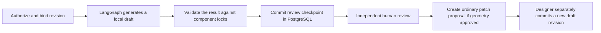

# Application Agent Harness contract

> P00 reconciliation: P00_CONTRACTS.md governs proposed route, field, event and lifecycle semantics; P00_SCOPE.md supplies stable journey names. Older examples below are historical where inconsistent.

## Core boundary
Claude Code development harness (`.claude`) is distinct from product runtime harness (`packages/harness`). LangGraph controls sequence; harness controls capabilities, budgets, tool context, state retention, approval, journaling, and telemetry.

## Modules and typed interfaces
`AgentDefinition(name, version, allowed_tools, input_schema, output_schema, max_steps, max_tokens, timeout_ms)`; `ToolCapability(id, tenant_scope, operation, side_effect, required_role, max_calls)`; `RunContext(run_id, organization_id, actor_id, approved_revision, read_scope, budget)`; `ToolAttempt(idempotency_key, status, request_digest, response_digest, trace_id)`; `Checkpoint(run_id, graph_state_hash, pending_approval_id)`; `ValidationFinding(rule, severity, evidence)`.

## Execution algorithm
1. Authorize actor and garment access; get explicit capability grant.
2. Build minimal context from approved DGT plus relevant records; never dump all prior chats.
3. Let graph route to only required agents; max step/token/spend budgets enforced server-side.
4. Broker validates each invocation, schemas and allowed data; journal intent before side effect.
5. Execute via provider adapter; sanitize outputs; attach provenance.
6. Deterministic rules check version locks and facts; reviewer may flag but cannot approve.
7. Suspend for human approval; bind decision to immutable revision hash and actor.
8. Persist result + event via outbox; resume safely on crash with GET-only recovery or idempotent request semantics.

## Isolation & observability
Read-only agents never get write tools. Network fetch uses allowlisted safe proxy with SSRF protection. Secrets not in context or prompts. Trace per-agent step count, latency, request id, model deployment, input/output token usage, prompt hash and error category; redact personal images. Context compression must preserve approved constraints and citations, with immutable IDs. Harness² candidate tuning is offline and promotion requires reviewed benchmark evidence.

## Implemented local workflow

The graph runs two fixed local steps. It accepts an offline raster fixture request or a designer-supplied geometry change for one component. The graph receives the selected revision and the bounded edit input. External tracing is disabled for this graph. The database records a digest of the revision, result and preview. The creator may cancel. Another human designer or patternmaker may approve or reject. Approval checks the current revision and digest again. For geometry, approval records a normal patch proposal. The ordinary designer acceptance endpoint still controls revision creation.

The review wait occurs at a persisted application boundary after the graph completes. Review can resume in a new API process. Start and decision writes are idempotent and scoped to the garment and organization. No live tool calls run inside this graph. The existing tool-attempt journal remains available for the later external worker integration. Tenant-scoped retrieval, native graph interrupts, live-tool budgets and operational reconciliation remain open. [LangGraph interrupt behavior](https://docs.langchain.com/oss/python/langgraph/interrupts)
