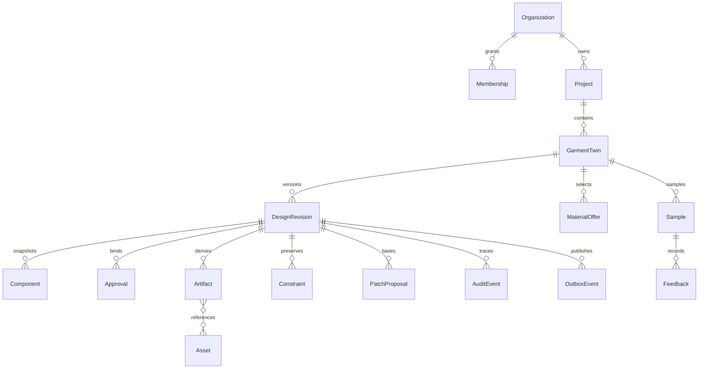

# P00 consolidated domain and interface contract
Status: PROPOSED. No endpoint or security control described here is implemented.

## Domain dictionary
Every scoped record carries organization_id, id, created_at and created_by. IDs are opaque strings; server-created production IDs will be UUIDs. Timestamps use UTC RFC3339. Monetary amounts and quantities use decimal strings, never binary floating point. Provenance contains source_id, source_kind, retrieved_at, license_status and content_hash; synthetic fixtures use source_kind=synthetic and cannot support commercial claims.

| Record | Essential fields and relationships |
|---|---|
| Membership | user_id, organization_id, role, active; project grants restrict membership further |
| Project | organization_id, name, authorized member grants |
| GarmentTwin | project_id, draft_revision_id, approved_revision_id, approval-purpose index |
| Component | stable id, parent_id, kind; versioned geometry in revision payload |
| DesignRevision | garment_id, parent_revision_id, canonical payload, content_hash; immutable |
| Constraint | component_id, hard/soft/required_evidence/professional_review, value, origin; unknown evidence is explicit |
| Asset | private storage key, media type, hash, consent, rights, source revision |
| MaterialCatalogItem / Offer | composition, width, measured properties; offer currency, price, unit, timestamp, stock evidence; null means unknown |
| Artifact | type, revision_id, derived_from IDs/hashes, generator version, current/needs_review/draft status |
| Approval | revision_id, content_hash, actor_id, role, organization_id, purpose, decision, timestamp |
| PatchProposal | garment_id, base_revision, operations, justification, preview hash, proposed/accepted/rejected/expired |
| UnlockRequest | constraint_id, base_revision, reason, requester, authorized decision; separate from geometry edit |
| ResearchSource / Claim | immutable snapshot hash, date, rights; claim text and source span |
| Sample / Feedback | physical sample id, source revision, component region, observation, supplied measurement origin |
| AuditEvent / OutboxEvent | actor, aggregate, revision, causation, payload version; append-only audit and transactional delivery intent |

## Revision, lock and approval semantics
A designer or patternmaker may propose scoped edits. A proposal and its preview do not change the DGT. An authorized designer accepting a patch creates an immutable child revision and advances the draft head in one transaction with audit and outbox records. It does not advance approved state. Undo after commit creates a compensating child revision; redo is another checked edit. Local uncommitted canvas undo is editor state.

Approval is a separate authenticated human command. Aesthetic approval by designer/client-reviewer advances approved_revision_id only when that exact revision is still draft head. Technical approval by patternmaker and handoff approval by production bind the same revision independently; they never imply aesthetic approval. All required purposes must match the export revision. A new draft preserves older approvals as historical evidence and marks affected artifacts needs_review. Preview images never become technical evidence.

A hard lock protects geometry and semantic attributes, including ancestor deletion or transform that affects the locked descendant. Designer requests unlock; org-admin separately authorizes it for an exact revision and constraint. Applying unlock creates a child draft with audit; it does not edit geometry or invalidate historical approval records. A subsequent geometry edit requires the new base revision. Approval of an unlock never approves a garment.

Hash algorithm: SHA-256 over UTF-8 canonical JSON payload with sorted keys, compact separators, no NaN, integer geometry coordinates and decimal strings for measured values. IDs, source references and locks are inside payload; volatile timestamps and hash field are outside. Arrays preserve order. Cross-language golden vectors must pass before P01 approval implementation.

## HTTP contract
All routes start /v1. Authorization context supplies actor and organization_id; client fields cannot grant authority. Every POST has Idempotency-Key. Commands changing a garment also require base_revision. Creation commands use the parent resource scope; initial garment revision has no base. Request digest includes actor, organization, method, route and canonical body. Same key and digest replays original result; same scoped key with a different digest returns 409. Re-authorize access before replaying a stored response.

| Operation | Route | Outcome |
|---|---|---|
| create project / garment | POST /v1/projects; POST /v1/projects/{id}/garments | scoped resource; garment starts at initial immutable draft |
| read garment | GET /v1/garments/{id} | draft, approved head, locks and purpose approvals |
| propose patch | POST /v1/garments/{id}/patch-proposals | 201 proposal; no revision change |
| preview | GET /v1/garments/{id}/patch-proposals/{patch_id}/preview | read-only diff and impact set; no provider call |
| accept patch | POST /v1/garments/{id}/patch-proposals/{patch_id}/accept | 201 child revision, diff, invalidated_artifacts, approval_status=unapproved |
| reject patch | POST /v1/garments/{id}/patch-proposals/{patch_id}/reject | proposal rejected; no revision change |
| request / decide unlock | POST /v1/garments/{id}/unlock-requests; POST /v1/garments/{id}/unlock-requests/{request_id}/decisions | separate scoped authorization and checked child revision on grant |
| decide revision approval | POST /v1/garments/{id}/approvals | revision_id, base_revision, content_hash, purpose, decision; actor from session |
| research / visual / technical draft | POST /v1/research/jobs; POST /v1/visuals/jobs; POST /v1/techpacks/drafts | 202 job bound to garment revision |
| material comparison | POST /v1/materials/compare | evidence and deterministic cost; no selection commit |
| sample feedback | POST /v1/samples/{id}/feedback | observation bound to sample and source revision |
| job / audit | GET /v1/jobs/{id}; GET /v1/garments/{id}/audit | authorized scope only |

Patch operations: create/update/delete/group/move/transform; target_component_id and typed payload; material selection uses update on garment material reference. Validate targets, bounded geometry, ownership, locks and base revision both at proposal and acceptance. Recompute preview on changed assumptions; never silently rebase. P01 implements only its bounded subset, not all listed routes.

Error envelope: {error: {code, message, request_id}}. 401 unauthenticated; 404 inaccessible/nonexistent resource to avoid tenant enumeration; 403 forbidden action on an accessible resource; 422 invalid payload or incomplete evidence; 409 stale_revision, locked_component, idempotency_conflict or approval_hash_mismatch. No raw provider response, credentials or private paths in messages. Approval hash and current-head checks occur inside the transaction.

## Events and job interfaces
Envelope: event_id, organization_id, aggregate_id, revision_id, schema_version=1, causation_id, occurred_at, event_type, payload. Types: canvas.patch.proposed (no committed change), design.revision.created, constraint.unlock.requested, constraint.unlock.decided, approval.requested, approval.decided, research.completed, material.alternative.proposed, cost.estimate.updated, spec.draft.created, sample.feedback.submitted. Delivery is at least once; consumers deduplicate by event_id. Proposal event revision_id is its base revision. Commit and outbox insertion are atomic.

Provider protocols: ChatProvider, VisionProvider, ImageProvider, EmbeddingProvider. Typed request contains task id, input revision, authorized asset references and budget; result contains status, artifact references, provenance, usage, duration and request id. Status: succeeded/failed/cancelled/capability_disabled. All live capabilities remain UNVERIFIED. No fallback that labels mock output live.

Harness admission takes RunContext(run_id, organization_id, actor_id, revision_id, allowed_tools, read_scope, max_steps, max_tokens, max_cost, timeout_ms). AgentDefinition declares version, tool set and input/output schemas. ToolAttempt records stable idempotency key, digest, status and trace id. Workflow states: requested, admitted, running, validating, awaiting_approval, committed, failed, cancelled, expired. Human-only approval endpoints are never agent capabilities. LangGraph checkpoints are not canonical design state. Persist intent before side effects; ambiguous non-idempotent results require reconciliation, never blind retry.

## Worked examples
1. Manual sleeve edit: r1 draft → propose selected sleeve update → preview → designer accepts at r1 → r2 unapproved; neckline geometry and lock identical; render becomes needs_review.
2. Neckline modification: proposal targets locked neckline (including indirect parent transforms) → 409 locked_component; heads, geometry and audit of prior approval unchanged; denied attempt recorded separately.
3. Fabric replacement: approved r1 → compare three synthetic offers → compatible candidate proposed → designer accepts child r2 → render/BOM/spec needs_review → aesthetic and technical reviews bind r2 hash; no supplier message.
4. Stale approval: r2 preview approved by user after r3 committed → 409 stale_revision; no approval granted and approved head unchanged.
